<div align="center">

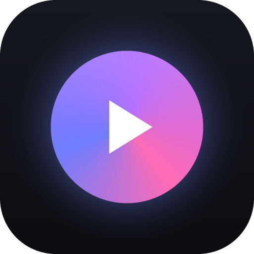

# Lumiar

**Editor de vídeo para computador, feito para quem gosta de efeito, transição e filtro.**
Roda no Windows, no Linux e no macOS, e tudo (inclusive legendas automáticas e voz sintética) funciona sem internet.
A interface está em português, inglês e espanhol ([como traduzir](docs/TRADUCAO.md)).

[**Baixar para Windows**](https://github.com/MikaelCosta05/lumiar/releases/latest) ·
[**Baixar para Linux**](https://github.com/MikaelCosta05/lumiar/releases/latest) ·
[**Baixar para macOS**](https://github.com/MikaelCosta05/lumiar/releases/latest) ·
[Rodar pelo código](#rodando-pelo-código)

<br>

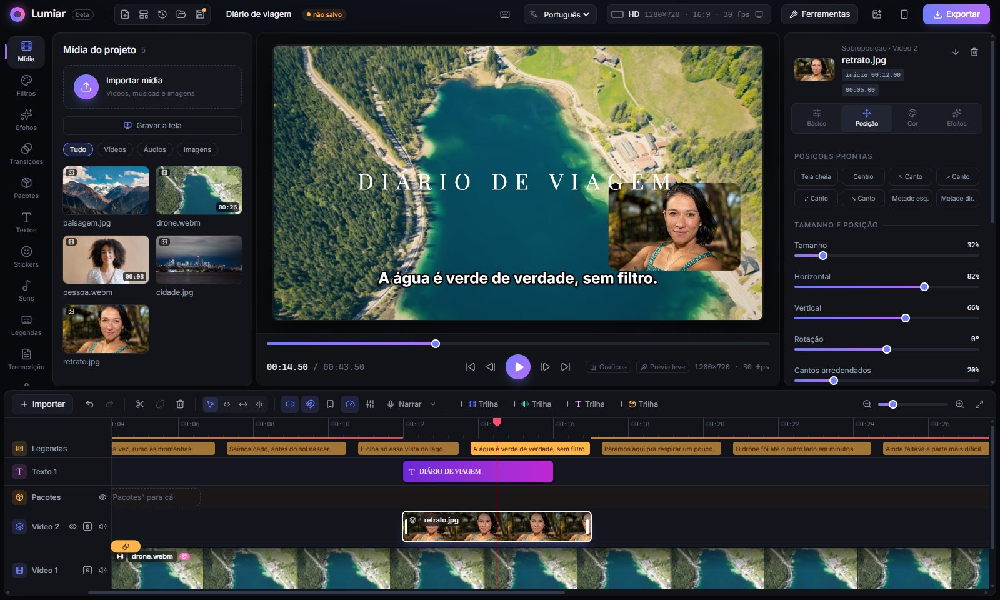

</div>

---

Comecei o Lumiar porque queria um editor no estilo do Filmora em que eu pudesse inventar os meus próprios
efeitos e transições. Hoje ele vem com **160 filtros, 75 transições, 96 efeitos, 333 pacotes de edição, 59 stickers, 10 elementos animados e 34 efeitos sonoros prontos**. Cada filtro, efeito e transição é só uma
pastinha com um shader. Se você souber um pouco de GLSL, dá para criar o seu em minutos: direto no programa, pelo
**Editor de efeitos** (Ferramentas), ou no código ([guia aqui](docs/PLUGINS.md)).

Tudo é processado na placa de vídeo (WebGL2), então o preview mostra exatamente o que vai sair no arquivo final.
Entre um efeito e outro a imagem fica em 16 bits, e a saída tem dither: degradês de céu, vinheta e brilho não fazem
degraus, mesmo com vários efeitos empilhados.

Ao abrir, uma tela de carregamento deixa pronto o que o editor usa logo de cara (fontes, janelas, mídias de exemplo,
o recorte da pessoa e as miniaturas de todos os filtros, efeitos, transições e pacotes). Na primeira vez leva uns 30 s;
as miniaturas ficam guardadas e as aberturas seguintes levam poucos segundos. Quem não quiser esperar clica em
*Entrar agora*, e o resto termina por trás.

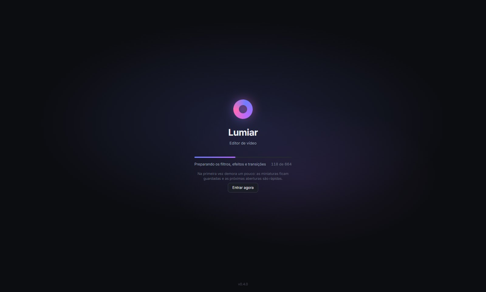

### Novidades da 0.4

- **Visual novo**: a biblioteca, o vídeo, o painel de ajustes e a timeline viraram painéis soltos, de cantos
  arredondados, e cada um muda de largura arrastando a borda (dois cliques voltam ao padrão).
- **Tela de carregamento** que deixa tudo pronto antes de abrir: as abas de filtros e pacotes abrem na hora.
- **Legendas bem mais precisas**: o Whisper erra muito menos palavras (de 13% para 3% no modelo "Precisa") e não
  inventa frase no silêncio. Legenda rápida demais para ler fica marcada, e corrigir uma palavra não estraga o tempo
  das outras. [Mais aqui](#textos-e-legendas).
- **Som do Discord (ou de outro programa) numa trilha separada** ao gravar a tela, com o microfone e o resto do
  computador em outras trilhas. [Mais aqui](#gravar-a-tela).
- **Câmera lenta fluida**, **curvas de animação** com alças, **bloco de ajuste**, **paleta de comandos** (Ctrl+K),
  **exportar com fundo transparente**, aba **Transcrição** para editar pelo texto e efeitos novos (partículas e raios
  de luz, brilho, retrato high-key, trocar a cor de um objeto).

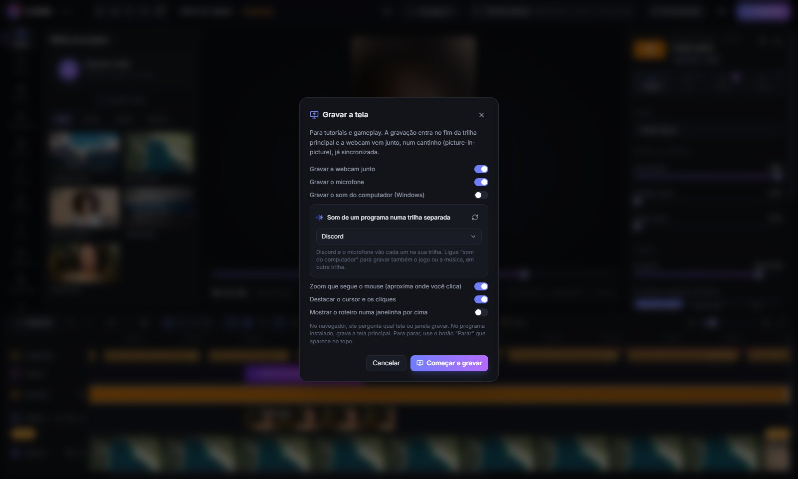

## O que dá para fazer

### Linha do tempo

- Uma trilha principal magnética (os clipes se encaixam sozinhos) e quantas **trilhas de vídeo, áudio e texto**
  você quiser por cima.
- Puxe as bordas para cortar, aperte **S** para dividir no cursor, arraste entre trilhas. O ímã gruda nas bordas
  dos outros clipes e nos marcadores.
- **Clique direito em qualquer coisa** abre o menu daquilo: duplicar, copiar e colar, mudar a velocidade,
  separar o áudio, congelar o quadro, inverter o clipe, copiar o filtro de um clipe para outro…

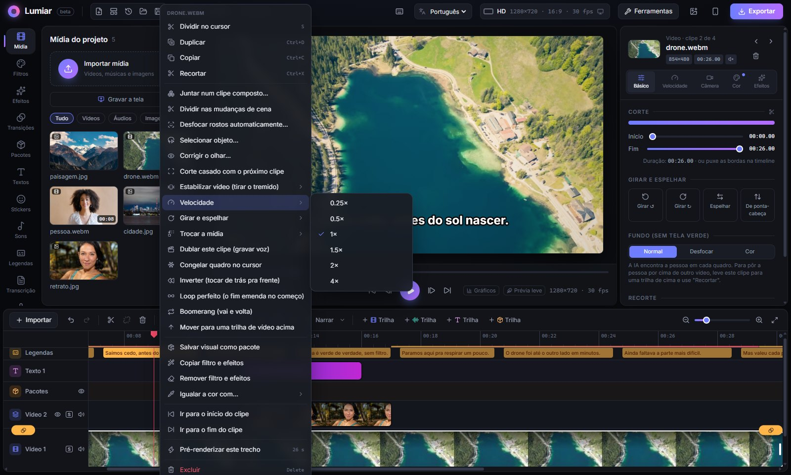

- **Picture-in-picture**: coloque um vídeo por cima de outro, arraste ele direto no preview, arredonde os cantos,
  mude a opacidade ou o modo de mesclagem. Tem também **chroma key** para apagar fundo verde.
- **Formas (máscaras)**: recorte a sobreposição num círculo, retângulo, coração, estrela ou losango, com borda suave
  e opção de inverter (mostrar só o lado de fora).
- **Máscara desenhada à mão** (✎ na Forma da camada): clique no vídeo para pôr os pontos, arraste para mover e use o
  botão direito para apagar. Com *Animar a forma*, cada ajuste vira um keyframe e a forma acompanha o movimento.
- **Remover o fundo sem tela verde**: a IA separa a pessoa do resto em cada quadro, no seu computador. Dá para
  desfocar só o fundo (modo retrato), trocar por uma cor ou, numa trilha de cima, recortar a pessoa e pôr por cima
  de outro vídeo.
- **Selecionar qualquer objeto com um clique**: clique direito no clipe → *Selecionar objeto…*. Clique no objeto
  (botão direito marca o que não faz parte) e a IA mostra a seleção na hora; *Aplicar* segue o objeto pelo clipe
  todo. Em *Recorte* (painel do clipe), troque entre a pessoa (automático) e o objeto selecionado: o fundo, o
  contorno, recortar, o texto atrás e os efeitos *Desfocar o objeto* e *Apagar o objeto* passam a usar o objeto. O
  modelo (SlimSAM) é baixado na primeira vez; a seleção fica salva no projeto.
- **Trocar a cor de um objeto**: no *Selecionar objeto…*, escolha em *O que fazer com o objeto* a opção *Trocar a cor
  do objeto* e a cor nova, e clique em *Aplicar*. Só o objeto muda de cor (a camiseta, o carro, o cabelo); a luz, a
  sombra e a textura continuam. No painel do clipe, em *Efeitos*, ajuste a saturação, clarear ou escurecer, a margem e
  *Proteger a pele*. Objetos finos e estampados (um vestido florido) são mais difíceis de selecionar.
- **Olhar para a câmera**: para quem lê o roteiro e não olha para a lente. Clique direito no clipe → *Corrigir o
  olhar…*. O Lumiar acha os olhos em cada quadro e leva a íris para onde ela estaria olhando para a câmera; olho
  fechado ou piscando não mexe. No painel do clipe, em *Olhar para a câmera*, ajuste a *Intensidade* e *Na vertical*.
  Funciona melhor com o rosto de frente, bem iluminado e com correções pequenas (o roteiro logo abaixo da câmera);
  desvios grandes ficam com cara de olho pintado.
- **Mover o resto junto** (🔗 na barra da timeline, ligado por padrão): ao cortar ou excluir na trilha principal,
  textos, áudios, sobreposições, pacotes, marcadores e legendas andam junto e continuam sincronizados.
- **Marcadores** (tecla **M**) para anotar pontos importantes, e **Ctrl + ← / →** pula entre cortes.
- Desfazer e refazer (até 200 passos), salvamento automático e um arquivo `.lumiar` que guarda o projeto e as mídias juntos.
- **Histórico** (ícone de relógio no topo): a lista do que foi feito nesta sessão, para voltar direto a um ponto, e as
  **cópias de segurança** que o Lumiar guarda sozinho a cada 5 minutos de edição (as 15 mais recentes).
- **Versões do projeto** (Histórico → aba **Versões**): guarde o projeto com um nome ("versão do cliente", "versão
  curta"…) e volte a ele quando quiser. As versões vão dentro do arquivo `.lumiar`. Em cada uma: **Abrir** (Ctrl+Z
  desfaz), **Atualizar** com o projeto atual, **Duplicar**, **Renomear** e **Apagar**. Uma mídia que só uma versão usa
  continua guardada no arquivo.
- **Loop perfeito e boomerang**: clique direito num vídeo da trilha principal → *Loop perfeito* (o começo aparece aos
  poucos por cima do fim, em meio segundo: repetido, não dá para ver a emenda) ou *Boomerang* (a cópia invertida entra
  logo depois, com a câmera tocando ao contrário). Na janela **Exportar**, a opção **Loop** faz o mesmo com o vídeo
  inteiro ou o GIF.
- **Agrupar**: clique direito num texto, som, sobreposição ou pacote → *Agrupar com o que está neste trecho*. Arrastar
  um item do grupo leva os outros junto.
- **Selecionar vários itens**: Ctrl (ou Shift) + clique, ou arraste um retângulo na área vazia da timeline. Os
  selecionados andam juntos, saem juntos com Delete, recebem juntos o filtro ou efeito clicado na biblioteca e podem
  virar um grupo pelo clique direito.
- **Comentários e tarefas**: clique direito na timeline → *Adicionar comentário aqui* ("trocar essa música", "cortar
  aqui"). Os balões ficam na régua; marcar como feito deixa o balão verde. A lista toda fica em Ferramentas.
- **Medidor de ritmo** (ícone de velocímetro na barra da timeline): uma faixa na régua marca os trechos com 7 s ou mais
  sem nada mudando na tela (corte, zoom, texto, camada), onde quem assiste costuma desistir.
- **Paleta de comandos** (**Ctrl+K**, Cmd+K no Mac): ache qualquer filtro, efeito, transição, pacote, sticker, som ou
  ação dos menus digitando o nome ("glicth" acha "Glitch") e aperte Enter: aplica no clipe selecionado ou no cursor,
  como um clique na biblioteca. Os usados por último aparecem primeiro.
- **Painéis do seu tamanho**: arraste a borda da biblioteca, do painel de ajustes ou da timeline para dar mais espaço a
  cada um; dois cliques na borda voltam ao tamanho padrão, e o programa lembra na próxima vez.
- **Atalhos de editor profissional**: J/K/L para tocar para trás, pausar e para frente (apertando de novo, 2× e 4×),
  Q/W para cortar do começo do clipe até o cursor ou do cursor até o fim, e Alt+arrastar para duplicar.
- **Slip, slide e roll** (seletor na barra da timeline, ou as teclas Y, U e N; V volta para a seleção): o *slip*
  troca o trecho mostrado dentro do clipe sem mudar o lugar nem o tamanho (vale também para sobreposições e áudios);
  o *slide* move um clipe da trilha principal entre os vizinhos, que se ajustam; o *roll* arrasta o corte entre dois
  clipes, um cresce e o outro diminui. Slide e roll não mudam a duração total, e durante o arrasto uma dica mostra os
  novos pontos de entrada e saída com os quadros dos dois lados.

### Filtros, efeitos e transições

As bibliotecas são organizadas em linhas por categoria, cada uma com um "Ver todos". Passe o mouse em cima de
uma miniatura e ela mostra o efeito animado. Para aplicar, é só clicar com o clipe selecionado ou arrastar até a timeline.

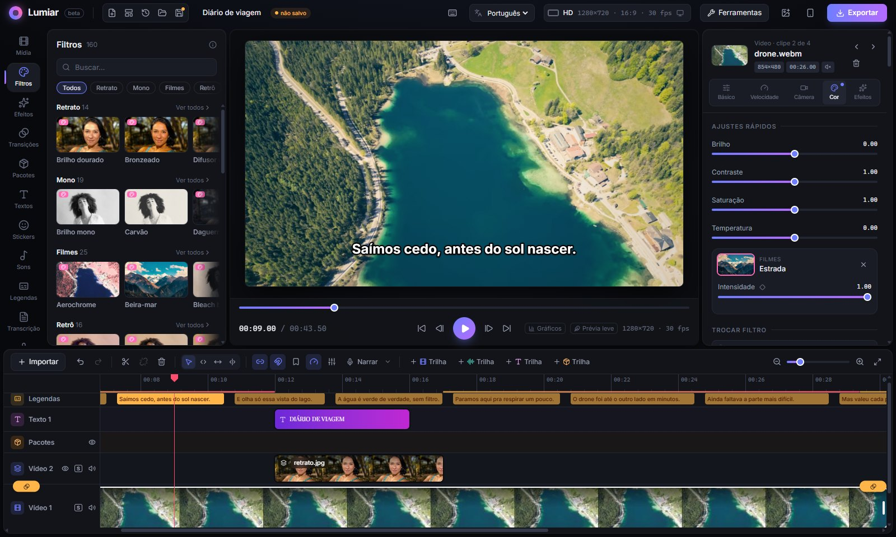

- **Filtros**: retrato (pele suave, brilho dourado), preto e branco, filmes antigos (Kodachrome, Portra, Cinestill),
  retrô (VHS, Polaroid) e ferramentas de correção (nitidez, restaurar, exposição e branco automáticos).
  Todos têm controle de intensidade.
- **Efeitos**: glitch, VHS, pintura a óleo, aquarela, arte ASCII, câmera térmica, chuva, neve, partículas,
  lente olho de peixe e muito mais. Dá para empilhar vários no mesmo clipe.
- **Transições**: das clássicas (dissolver, cortina) às de impacto, como onda de choque, vidro quebrado,
  terremoto, zoom de tensão e câmera de vídeo.

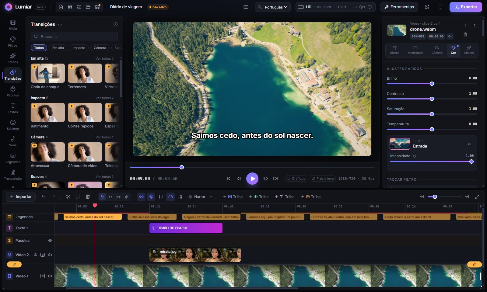

**Efeitos na pessoa** (categoria *Pessoa*): a IA encontra a pessoa em cada quadro, sem tela verde.

- **Contorno brilhante**: uma linha neon acompanha o corpo, pulsando ou trocando de cor.
- **Clones**: a mesma pessoa 2 a 4 vezes na tela, cada cópia um pouco atrasada, em fila ou no mesmo lugar.
- **Desintegrar**: a pessoa vira poeira e voa com o vento (o estalo do Thanos), ou se forma a partir dela.
- **Rastro da pessoa**: só ela deixa cópias transparentes e coloridas para trás; o fundo continua limpo.
- **Congelar a pessoa**: ela para no meio do pulo e o mundo continua, ou o mundo congela e só ela se mexe.
- **Sair da moldura**: o vídeo vira um quadro menor, inclinado, e a pessoa salta para fora da borda.
- **Rabiscos animados**: contorno desenhado à mão, tremendo, com estrelinhas, corações e brilhos em volta.
- **Texto atrás da pessoa**: na aba Posição do texto (ou no clique direito), *Atrás da pessoa* põe o título entre
  ela e o fundo.

**Efeitos com o tempo** (categoria *Tempo*): usam os quadros anteriores. Tocando, aparecem na hora; pausado ou depois
de arrastar o cursor, o Lumiar calcula o segundo anterior por trás e, num instante, mostra o quadro igual ao da
exportação.

- **Time warp scan**: uma linha atravessa a tela congelando o que fica para trás (o filtro que estica rostos).
- **Datamosh**: os pixels não se renovam e a imagem escorre junto com o movimento. Também existe como transição: o
  clipe atual escorre pelo movimento do próximo.
- **Eco temporal / estroboscópio**: rastros de luz do movimento, ou cópias nítidas da pessoa em intervalos.

**Efeitos com profundidade** (categoria *Profundidade*): a mesma IA da Foto 3D, agora no vídeo.

- **Trocar o céu**: pôr do sol, noite estrelada, aurora ou céu azul, com a luz da cena acompanhando.
- **Foco que muda**: o desfoque passa da frente para o fundo como numa lente de cinema.
- **Neblina e luz no fundo**: névoa e raios de luz só atrás da pessoa; o que está perto continua nítido.

E duas transições novas: **Pela silhueta** (o próximo clipe aparece dentro do corpo da pessoa e cresce até tomar
a tela) e **Zoom infinito** (a câmera entra num ponto da imagem e sai no próximo clipe).

**Mais efeitos na pessoa** (categoria *Pessoa*):

- **Pessoa invisível**: o corpo vira vidro. Dá para ver o fundo através da pessoa, torto como numa lente, e a borda
  cintila de leve.
- **Sombra atrasada**: a sombra da pessoa aparece na parede atrás dela, mas se mexe um pouco depois. Escolha o atraso,
  para que lado ela fica e quão escura.
- **Olhos brilhando**: os olhos acendem como os de um bicho no escuro, ou ficam totalmente pretos (*Modo*). Marque os
  dois olhos em *Olho da esquerda* e *Olho da direita*; com o *seguir rosto* ligado, os pontos padrão já caem nos olhos.

**Terror analógico** (categoria *Analógico*):

- **Quadro subliminar**: de vez em quando, um quadro diferente pisca por 1 a 3 quadros: negativo, contraste estourado,
  de cabeça para baixo ou o rosto bem de perto.
- **Tela de teste da TV**: as barras coloridas de fim de transmissão e a tela de "sem sinal" com chiado entram e saem
  sozinhas por cima da imagem.

**Arte e retrato:**

- **Pintura que se mexe** (*Arte*): o vídeo vira uma pintura de pinceladas grossas e redemoinhos, como os
  pós-impressionistas, e as pinceladas seguem o movimento da cena.
- **Luz de estúdio** (*Retrato*): ilumina a pessoa de novo depois de gravado. Escolha de que lado vem a luz, a altura, a
  cor, a força e se ela é dura ou suave. A IA usa a profundidade para saber o volume do rosto.

**Mais transições:**

- **Passar pela pessoa**: o corpo da pessoa do clipe atual varre a tela e deixa o próximo clipe por onde passa.
- **Por profundidade**: o próximo clipe aparece primeiro no que está longe e vem avançando até a frente.
- **Fita rebobinando**: o videocassete volta a fita cada vez mais rápido e corta para o próximo clipe no meio do chiado.
- **Queda de sinal**: a imagem trava, se desmancha em blocos de cor errada e volta já no próximo clipe.
- **Entrar pelo olho**: a câmera mergulha num olho até a pupila tomar a tela, e o próximo clipe se abre de dentro dela.
  Marque o olho em *Onde está o olho*.

- **Keyframes** em qualquer parâmetro: marque um valor num ponto e outro mais à frente, e o Lumiar anima entre os dois.
- **Correção de cor manual**, na aba Cor do clipe: rodas de sombras, meios-tons e altas luzes, saturação e curvas
  (geral, vermelho, verde e azul).
- **LUTs (.cube)**: importe os arquivos de cor usados no Premiere, DaVinci e Final Cut e aplique com intensidade.
  A LUT fica salva no projeto.
- **Desfocar área**: efeito para esconder placas, rostos e telas, com desfoque ou pixels.
- **Desfocar rostos automaticamente**: clique direito no clipe → *Desfocar rostos automaticamente…*. O Lumiar acha
  todos os rostos, mostra cada um numa miniatura para você escolher quais esconder, e o desfoque acompanha cada rosto
  enquanto ele se mexe (some quando o rosto sai de cena).
- **Apagar objeto**: efeito que some com um poste, uma pessoa no fundo ou um logo, preenchendo a área com as cores de
  volta. Se o objeto se mexe, clique direito no clipe → *Fazer o apagador seguir o objeto*. Funciona melhor em
  objetos pequenos sobre fundos simples (céu, parede, chão).
- **Melhorar imagem**: para vídeo escuro, granulado ou sem nitidez (celular à noite, webcam): clareia as sombras sem
  estourar o claro, tira o granulado e devolve a nitidez.
- **Gráficos de cor** (botão *Gráficos* embaixo do vídeo): histograma, forma de onda e vetorscópio do quadro atual,
  com a linha de tom de pele, para acertar exposição e cor com precisão.
- **Igualar a cor**: clique direito num clipe → *Igualar a cor com…* e escolha o clipe de referência (câmeras
  diferentes, luz que mudou). O ajuste vira curvas na correção manual.
- **Curvas de animação**: em cima de um keyframe, o botão de curva escolhe como ele chega no próximo (suave, linear,
  acelerando, freando, passando do ponto e voltando, elástico, quicando, e as exponenciais: arranca e freia forte,
  começa parado e dispara, rápido no meio). Em **Personalizada**, arraste as duas alças da curva (como o
  `cubic-bezier` do CSS, podendo passar do ponto) e veja uma bolinha fazendo o movimento; ela começa na forma da curva
  que estava escolhida, e os valores também podem ser digitados.

### Pacotes de edição

Pacotes são edições prontas que juntam filtro, efeitos e movimento de câmera, sem textos nem stickers. Ao aplicar um
pacote, ele vira um bloco numa trilha própria e vale para tudo o que está embaixo dele, só naquele trecho. Você
arrasta o bloco para o ponto certo e puxa as bordas para encaixar. As animações de entrada e saída se ajustam
sozinhas ao novo tamanho.

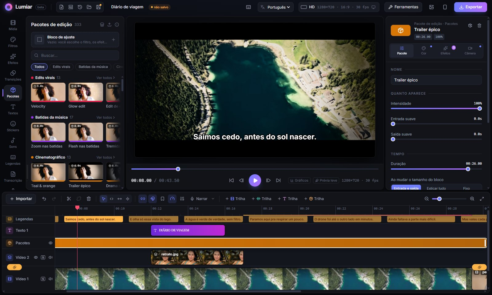

São 333 pacotes em 25 categorias. Alguns fazem bem mais do que mudar a cor:

- **Terror analógico** (24): o clima das fitas amaldiçoadas e das transmissões que não deviam estar no ar. Fita VHS
  doente e mofada, erro de tracking, imagem rolando na vertical, ruído da cabeça de vídeo, fantasma, quadros travando,
  pausa de fita, transmissão de emergência, câmera de vigilância, visão noturna, luz de lanterna, o zoom súbito no rosto,
  as barras coloridas de fim da programação, quadros escondidos e a sombra que não acompanha.
- **Found footage** (10): falso documentário e gravação encontrada: câmera perdida, fuga no escuro em visão noturna, a
  câmera caiu, arquivo corrompido, depoimento, webcam de madrugada, fim abrupto, câmera do quarto, zoom digital e
  brilho nos olhos.

- **Batidas da música**: o Lumiar ouve a música, encontra as batidas (e o BPM) e o pacote pulsa em cada uma, com
  zoom, flash, tremida, giro, P&B, estrobo, cores alternadas… As batidas ficam marcadas na régua e servem de ímã para
  os seus cortes. Os pacotes curtos (flash, glitch, soco de zoom) também podem ser repetidos em cada batida.
- **Seguir rosto**: o pacote procura o rosto no vídeo embaixo dele e a câmera acompanha a pessoa. Exemplos: close
  no rosto, aproximação lenta, entrevista que alterna entre plano aberto e fechado.
- **Câmera lenta e velocidade**: o pacote muda a velocidade do clipe naquele trecho. Tem câmera lenta fluida, rampas
  que freiam e aceleram, bullet time, timelapse e avanço rápido estilo VHS.
- **Edits virais**: velocity, glow edit, edit de carro, edit de anime, drop, POV…
- **Comédia e memes** (50): zoom dramático no rosto, olhar pra câmera, zoom triplo, vine boom, meme frito, silêncio
  constrangedor, "e foi aí que…", plot twist, cringe, "enquanto isso…"… Vários usam câmera lenta: queda épica,
  "esse sou eu" (quase congela no meio da confusão), "não acredito", "quaaase", vitória épica, câmera lenta
  desnecessária, tropeço. Outros aceleram, como o filme mudo e a perseguição acelerada.
- **Câmera em movimento**: câmera na mão, crash zoom, órbita, ângulo holandês, travelling, pêndulo, drone…
- **Cinematográfico**, **Impacto e ritmo**, **Passagens no corte**, **Aberturas e finais**, **Vlog**, **Retrô**,
  **Sonho e romance**, **Suspense e terror**, **Ação e games** (com a camuflagem óptica: a pessoa vira vidro),
  **Documentário e notícia** e **Clima e estações**.

**Pacotes por tema**, com cerca de dez receitas cada:

- **Casamento e eventos**: votos com pele bonita, entrada da noiva em câmera lenta, filme de casamento em tela larga,
  saída dos noivos, primeira dança com a câmera girando, luz de balada na pista (nas batidas), brinde, foto do álbum (a
  cena congela num flash e volta), detalhe das alianças e vista do alto de drone.
- **Moda e lookbook**: passarela com flashes de fotógrafo, editorial P&B, capa de revista (segue o rosto), lookbook
  suave, sessão de fotos no ritmo da música, flash dos anos 90, alta-costura, giro do look com rastro colorido, campanha
  em duas cores e luz de estúdio lateral (a IA reilumina a pessoa).
- **Esportes**: replay, grito de gol, lance congelado, câmera de ação, transmissão do jogo, velocidade máxima, vídeo de
  skate com olho de peixe, treino pesado (zoom nas batidas), jogo à noite e tensão do pênalti.
- **Datas comemorativas**: Natal, pisca-pisca, arraiá e quadrilha de São João, Halloween, gostosuras ou travessuras,
  virada do ano com fogos, parabéns e carnaval (as cores trocam a cada batida).
- **Produto e unboxing**: abrindo a caixa, revelação do produto, brilho de comercial, fundo infinito, produto de luxo,
  detalhe macro (a IA desfoca o fundo), cor de vitrine, review de tecnologia, reação ao produto e vista de cima.
- **Videoclipe**: luz de palco, clipe dos anos 2000, close de cantor, clones no ritmo, psicodélico, plano-sequência,
  clipe de rap, luz negra, balada na chuva e clipe pintado (pinceladas que seguem o movimento).

Os pacotes não trazem som, texto nem sticker: isso fica nas abas **Sons**, **Textos** e **Stickers**, para pôr só onde
você quiser. Nos pacotes de câmera lenta, o trecho lento pode ficar mudo.

Nos pacotes de **câmera lenta**, uma linha branca com ◆ no bloco marca o momento (o começo da parte mais lenta).
Arraste essa alça até o instante exato do tombo ou do susto e o vídeo é refeito ali. Arrastar o bloco inteiro também
leva a câmera lenta junto, e excluir o bloco devolve o vídeo à velocidade normal.

Cada pacote sabe onde entrar:

- Os de **visual** cobrem o clipe selecionado.
- Os **momentos** (batida, impacto, câmera lenta) começam no cursor.
- As **passagens** ficam centralizadas no corte mais próximo.
- As **aberturas** e os **finais** encostam no começo ou no fim do clipe.
- Os de **batida** cobrem a música inteira (ou o clipe selecionado).

No painel da direita dá para baixar a intensidade, suavizar a entrada e a saída, ligar e desligar cada efeito ou
trocar o filtro, sem mexer no pacote original.

**Bloco de ajuste** (no topo da aba Pacotes, no clique direito da timeline ou pelo Ctrl+K): um pacote vazio. Ponha na
trilha de pacotes, puxe as bordas e escolha nele o filtro, a cor (ajustes rápidos, rodas, curvas e LUT, como na aba Cor
do clipe), os efeitos e a câmera: vale para tudo o que está embaixo, só naquele trecho. A aba Cor de qualquer pacote tem
o mesmo. Dá para salvar como meu pacote, e a cor (até a LUT) vai junto para outros projetos.

Também dá para trabalhar como numa action do Photoshop:

- **Fixar direto no clipe** (botão direito no pacote) grava o filtro, os efeitos e a câmera do pacote no próprio clipe.
- **Salvar como meu pacote** guarda um bloco ajustado, ou o visual de um clipe, em "Meus pacotes" para usar de novo
  em outros projetos. A câmera lenta do bloco vai junto.
- Os botões no topo da aba exportam "Meus pacotes" para um arquivo `.lumiarpack` e importam de volta, para levar a
  outro computador ou mandar para alguém.

### Stickers e efeitos sonoros

- **Stickers**: 59 emojis grandes e animados (😂 💀 🔥 👀 🤯 👉 ⭕ ❌ ✅ 🏆…), que quicam, tremem, giram, pulsam ou
  apontam. Funcionam como um texto: dá para arrastar no vídeo, mudar o tamanho e trocar a animação.
- **Efeitos sonoros**: 34 sons gerados pelo próprio Lumiar, sem baixar nada: vine boom, trombone triste, grilos,
  ba-dum-tss, boing, disco arranhado, bip de censura, aplausos, whoosh, impacto, boom de cinema, "entrando em câmera
  lenta", coração batendo, dun dun duuun, moeda, vitória, sino de luta… Clique em ▶ para ouvir e no nome para pôr no
  cursor. Eles vão para a trilha "Efeitos sonoros".
- **Gerar música** (sem direitos autorais): na aba **Sons**, abra *Gerar música*. Escolha o estilo (lo-fi,
  tensão/suspense, épico/trailer, terror analógico, alegre/vlog ou eletrônico), a duração, o andamento (BPM), a
  intensidade e a variação (*Gerar outra* troca melodia, acordes e ritmo). **Ouvir** toca antes; **Pôr na timeline**
  coloca a música na trilha de música. A duração já vem certa (a do vídeo ou a do item selecionado), a música tem
  começo, meio e fim, e o último acorde termina exatamente no fim. As batidas já ficam marcadas na régua, prontas para
  *Montar os clipes no ritmo*. Tudo é composto na hora pelo Lumiar, sem internet e sem trechos de músicas de ninguém.

### Edição rápida

- **Montar pelo roteiro**: gravou cada frase várias vezes? Com o roteiro escrito (aba Voz) e o vídeo transcrito, o
  botão *Montar pelo roteiro* (aba Transcrição) acha as tentativas de cada frase, fica com a melhor (normalmente a última
  que saiu completa) e tira os erros, as repetições e a conversa no meio. Dá para trocar de tentativa antes de montar.
- **Gancho de abertura** (Ferramentas): o Lumiar acha os momentos mais fortes do vídeo e copia o escolhido para os
  primeiros segundos, como prévia, com um flash antes do vídeo começar de verdade.
- **Dividir nas mudanças de cena**: clique direito num vídeo longo (ou que já veio editado) e ele é cortado em cada
  troca de plano.
- **Imagens de apoio automáticas** (Ferramentas): enquanto você fala "a praia estava linda", entra por cima um trecho
  das suas mídias que mostra uma praia. Você confere a lista e desmarca o que não combinar.
- **Buscar nas mídias** (Ferramentas): ache o momento exato pelo que aparece ("cachorro", "pôr do sol", "carro
  vermelho") ou pelo que é falado, em todas as mídias do projeto, mesmo as que ainda não estão na timeline.
- **Cortar as pausas**: clique direito num clipe → *Cortar as pausas (silêncios)*. O Lumiar ouve o áudio, encontra
  os silêncios (o limite se ajusta ao ruído de fundo de cada vídeo) e tira todos, deixando uma folguinha antes e
  depois de cada fala. Ótimo para vlog, aula e podcast.
- **Sincronizar o áudio pela forma de onda**: gravou com um microfone separado? Clique direito no áudio → *Sincronizar
  com o vídeo (pelo som)* e ele se encaixa sozinho; o som da câmera fica mudo.
- **Multicâmera**: ponha as outras câmeras nas trilhas de vídeo de cima e use *Multicâmera: sincronizar as câmeras pelo
  som*. Depois, tocando o vídeo, aperte 1, 2, 3… para cortar entre as câmeras (1 = trilha principal).
- **Multicâmera automática**: *Multicâmera: cortar sozinho para quem fala* descobre quem está falando (pelo som de cada
  câmera, ou pelas vozes separadas nas legendas) e corta para a câmera daquela pessoa. Bom para podcast e entrevista.
- **Zoom automático na fala**: o Lumiar acha os momentos de ênfase (fala mais alta) e dá um zoom rápido em cada um,
  como fazem os youtubers. Cada zoom é um bloco que dá para mover ou apagar.
- **Destaques para Shorts e Reels**: em vídeos longos, o Lumiar sugere os trechos mais animados (30, 45 ou 60 s) e
  exporta cada um em 9:16.
- **Capítulos para o YouTube**: a partir dos marcadores (ou da fala transcrita), a lista "00:00 …" pronta para colar
  na descrição.
- **Encaixar a música na duração**: clique direito na música → *Encaixar a música na duração* (até o fim do vídeo,
  15, 30 ou 60 s). Em vez de cortar o final no meio de uma frase musical, o Lumiar tira (ou repete) um pedaço do meio,
  emendando em cima das batidas onde o som é parecido. O começo e o final de verdade da música ficam.
- **Montar no ritmo**: clique direito na música → *Montar os clipes no ritmo*. Cada clipe passa a durar 1, 2 ou 4
  batidas e os cortes caem exatamente em cima delas. Também dá para repetir os clipes (pegando outros trechos dos
  vídeos) até o fim da música.
- **Converter para vertical**: o botão 📱 ao lado do formato deixa o projeto em 9:16 (Reels, TikTok, Shorts) e cada
  clipe passa a acompanhar o rosto de quem aparece.
- **Prévia leve**: o botão embaixo do vídeo cria cópias em 540p dos vídeos pesados (4K, 1080p) só para editar. Tocar
  e pular na timeline fica muito mais rápido; a exportação continua usando os arquivos originais.
- **Pré-renderizar trecho**: efeitos pesados (na pessoa, com profundidade, datamosh, clones…) engasgam o preview? Clique
  direito no clipe (ou na régua) → *Pré-renderizar este trecho*. O Lumiar renderiza aquele pedaço uma vez, em 720p, e o
  preview passa a tocar dele, liso; uma faixa verde na régua mostra onde. Mexeu no trecho, ele volta a ser renderizado
  ao vivo até você pré-renderizar de novo. Fica só na memória (até 1,5 GB; os mais antigos saem primeiro).
- As prévias dos filtros, efeitos e pacotes (ao passar o mouse) mostram o **clipe selecionado**.

### Editar pelo texto

Na aba **Transcrição**, o Lumiar transcreve a fala do vídeo e mostra como um texto. Selecione palavras e aperte Delete: o
trecho sai do vídeo e todo o resto anda junto. Clicar numa palavra leva o cursor até ela.

O botão **Tirar vícios** encontra e remove de uma vez as hesitações ("é…", "hum", "ahn"), as muletas soltas ("tipo,",
"né?", "então…", "sabe?"), as palavras repetidas ("eu eu") e as frases recomeçadas ("eu fui, eu fui no mercado").
Em **Revisar um por um**, cada vício aparece numa lista para ouvir e desmarcar o que deve ficar.

### Câmera e velocidade

- Movimentos de câmera prontos (Ken Burns, panorâmica, zoom de impacto, drone, vertigem…) ou feitos à mão com keyframes.
- **Seguir rosto**: o editor encontra o rosto em cada quadro e mantém a pessoa enquadrada.
- **Seguir ponto**: clique em qualquer coisa no vídeo e a câmera acompanha.
- **Estabilizar vídeo tremido**: clique direito no clipe → *Estabilizar vídeo* (suave, média ou forte). O Lumiar mede
  o tremido quadro a quadro e a câmera compensa, com um zoom leve (no máximo 1,25×) para esconder as bordas. Soma com
  os keyframes e o "seguir rosto" que o clipe já tiver.
- **Texto e sticker que seguem algo**: na aba Posição do texto, escolha um ponto no vídeo e o texto (ou um 👉)
  gruda nele e anda junto.
- **Câmera lenta fluida**: abaixo de 1× o Lumiar cria os quadros que faltam estimando o movimento, em vez de repetir quadros.
- **Curva de velocidade**: na aba Velocidade, desenhe a rampa (lento no meio, freia até parar, bullet time…) e o
  clipe ganha uma aceleração e uma freada suaves.
- Girar 90°, espelhar, congelar quadro e tocar de trás para frente.
- **Desfoque de movimento**: o que anda rápido fica borrado na direção do movimento, como numa câmera de verdade:
  zoom, panorâmica e giro da câmera, pacotes com câmera, picture-in-picture e textos que entram deslizando, girando ou
  quicando. Fica no fim da aba **Câmera** do clipe ou do pacote. No projeto todo: *Desligado*, *Pacotes* (o padrão: só
  os pacotes com câmera, intensidade 50%) ou *Tudo*; em cada clipe ou pacote dá para seguir o projeto, desligar ou usar
  uma intensidade própria. No preview o desfoque é mais leve; o arquivo exportado sai com o desfoque completo.

### Rastreamento

- **Trocar a tela (4 cantos)**: põe um vídeo ou uma foto dentro da tela de um celular, de um quadro ou de uma placa do
  vídeo de baixo, em perspectiva. Clique direito na sobreposição → **Trocar a tela (rastrear 4 cantos)…** (ou aba
  **Posição** → **Marcar os 4 cantos…**), arraste os 4 cantos coloridos até os cantos da tela e clique em **Rastrear os
  cantos**. O Lumiar segue os cantos quadro a quadro. Para ajustar, pare o cursor em outro momento e abra de novo:
  **Corrigir aqui** muda só em volta daquele momento; **Rastrear de novo daqui** refaz o rastro. **Usar sem rastrear**
  deixa os cantos parados (bom para fotos). O vídeo de baixo precisa estar na trilha principal.
- **A forma acompanha**: a forma da sobreposição (círculo, estrela ou a desenhada à mão com ✎) anda junto com algo do
  vídeo. Na aba **Posição**, abaixo de **Forma (máscara)**, escolha **Um ponto** (o centro da forma, ou clique em
  **Escolher o ponto no vídeo…**) ou **O objeto** (o de **Selecionar objeto**). Ligue **Crescer e diminuir junto** e
  **Girar junto** (só na forma desenhada) se o objeto se aproximar ou girar.
- **Corte casado automático**: clique direito entre dois clipes da trilha principal → **Corte casado automático** (ou
  no clipe → **Corte casado com o próximo clipe**). O Lumiar procura, no fim do primeiro e no começo do segundo, os
  dois quadros com a forma e a composição mais parecidas, muda os pontos de corte e, se ajudar, aproxima e move o
  segundo clipe para as formas caírem no mesmo lugar. Com **Mover o resto junto** ligado, o que está depois do corte
  acompanha. Um aviso diz o que mudou; **Ctrl+Z** desfaz.

### Textos e legendas

- **Elementos animados** (aba Stickers): barra de progresso do vídeo, botão "inscreva-se" com a mãozinha e o sino,
  contagem regressiva, seta e círculo que se desenham e balão de fala.
- **Rota animada no mapa**: escolha as cidades (148 no Brasil e no mundo) e uma linha anima de uma até a outra, com
  avião, carro ou navio na ponta e o nome de cada cidade aparecendo quando é alcançada. Temas escuro, claro e papel antigo.
- **Ondas de som**: barras, espelho, círculo ou linha que pulam com o som do projeto. Com uma imagem de fundo e as
  legendas, transforma um podcast só de áudio em vídeo para o Instagram e o YouTube.
- **Digitação animada** (aba Textos): código aparecendo letra por letra numa janela de editor, com as cores de
  código e o cursor piscando, um terminal ou só o texto. Velocidade ajustável.
- 34 estilos de título prontos (neon, cinema, 8-bit, máquina de escrever, código digitando, faixa de nome…), 10 fontes e animações
  de entrada, saída e contínuas.
- **Legendas automáticas** com o Whisper, rodando no seu computador: cada palavra ganha o seu tempo e dá para usar
  estilos como o "destaque" do TikTok, em que a palavra falada muda de cor. Também importa e exporta `.srt` e `.vtt`.
  Em vídeos longos mostra a porcentagem e quanto falta, pula os trechos em silêncio e dá para cancelar.
  Antes de ouvir, o Lumiar ajusta o volume da voz (legenda até gravação baixa), acha onde há fala e encolhe os
  silêncios longos (o Whisper não inventa frase na música nem na pausa); a frase que ele pula é ouvida de novo, e o
  começo e o fim de cada palavra acompanham a voz com precisão de 20 ms. O modelo padrão é o "Precisa".
- **Editar as legendas**: corrija o texto na lista da aba Legendas, ou dê dois cliques numa legenda (na timeline ou
  no preview) para ir direto ao texto dela. Na timeline, arraste a legenda para mudar o tempo ou puxe as bordas.
  Corrigir uma palavra mantém o tempo das outras (o destaque da palavra falada continua certo). Legenda rápida demais
  para ler fica marcada com os caracteres por segundo, e um clique dá a ela mais tempo de tela pela pausa ao lado.
- **Legendas traduzidas para o inglês**: o Whisper ouve em português (ou outro idioma) e escreve em inglês.
- **Legendas em outros idiomas** (aba Legendas → Outros idiomas): traduz para inglês, espanhol, francês, italiano ou
  português e baixa um .srt por idioma (para enviar ao YouTube), ou troca as legendas da tela.
- **Legendas com cor por pessoa**: na aba Legendas, *Separar as vozes* reconhece quem fala em cada legenda (pelo
  timbre e pela altura da voz, de 2 a 4 pessoas) e dá uma cor e um nome a cada uma, que pode aparecer acima da legenda.
- **Nome de cada pessoa na tela**: depois de *Separar as vozes*, clique em *Pôr o nome de cada pessoa na tela*. Digite o
  nome de cada voz (e, se quiser, o cargo ou @perfil) e quanto tempo fica (3, 4 ou 6 s). Cada pessoa ganha uma "Faixa
  de nome" na primeira vez que fala, com as cores e a fonte do Kit da marca, se houver. Cada faixa é um texto comum;
  rodar de novo troca as faixas antigas em vez de duplicar.

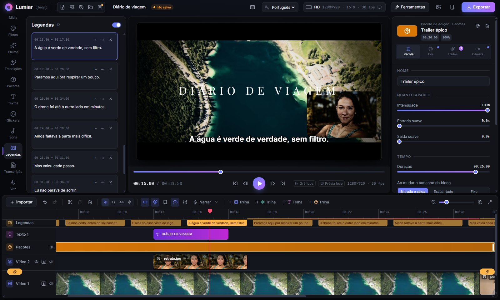

### Voz: narração e dublagem

- **Grave a narração** com o vídeo tocando junto. Você escolhe o microfone, testa o volume, tem contagem regressiva
  e um **teleprompter** que rola o seu roteiro por cima do vídeo. Com *Acompanhar a minha voz*, ele só anda enquanto
  você fala: parou para respirar ou pensar, o texto espera.
- **Dublagem**: selecione um clipe e grave por cima dele, no tempo certo. A gravação para sozinha no fim do clipe.

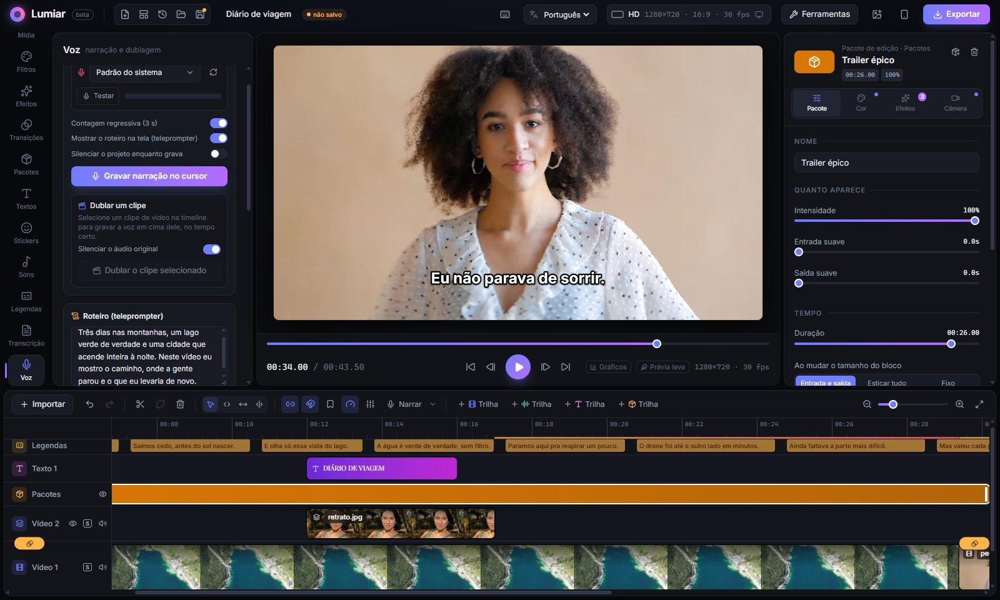

- **Voz sintética** em português, inglês e espanhol, gerada sem internet. Dá até para dublar automaticamente todas as legendas.
- **Efeitos de voz**: voz limpa (estilo podcast), telefone, rádio, megafone, eco, caverna, robô, debaixo d'água,
  monstro e esquilo.
- A música **abaixa sozinha** enquanto alguém fala e volta depois.
- **Dublar o vídeo em inglês** (aba Voz): o Whisper ouve a fala, traduz e a voz sintética em inglês fala cada frase no
  mesmo instante (acelerando um pouco quando não cabe); o som original fica baixinho por baixo.
- **Limpar o áudio**: tira chiado, ventilador, ar-condicionado e ronco de fundo (leve, médio ou forte). Cria uma cópia
  limpa; o arquivo original fica intacto.
- **Tirar o vento** e **tirar estalos de boca**: no mesmo menu (clique direito → *Limpar o áudio (tirar ruído)*).
  *Tirar o vento* abaixa as rajadas graves e liga um filtro que só age enquanto venta; *Tirar estalos de boca* acha os
  cliques de saliva e lábios e preenche o buraco com o som de antes e de depois; *Tirar ruído, vento e estalos* faz tudo
  junto. Com vento forte, parte dos graves de uma voz grave também cai.
- **Equalizador** de graves, médios e agudos, com atalhos como "voz mais clara" e "tirar chiado".
- **Separar a voz da música**: clique direito no áudio (ou no vídeo) → *Separar a voz da música*. A voz vai para a
  trilha de narração e o resto (música, fundo) para uma trilha de música, para baixar, silenciar ou trocar cada parte.
- **Volume por trecho**: dois cliques no áudio na timeline criam pontos numa linha amarela; arraste para subir ou
  descer o volume só naquela parte.
- **Mixer de áudio** (ícone de controles deslizantes na barra da timeline): um canal para o som da trilha principal,
  um para cada trilha de vídeo com som e um para cada trilha de áudio (narração, música, efeitos sonoros…), mais o
  Master. Cada canal tem fader em dB (de −∞ a +6), pan, mudo (o mesmo botão do cabeçalho da trilha), solo (**S**,
  também no cabeçalho: com algum solo ligado, só os canais em solo tocam) e um medidor de pico e RMS enquanto o vídeo
  toca. O Master mostra o pico e a sonoridade dos últimos 3 s em LUFS. Os ajustes ficam no projeto e saem iguais na
  exportação (se o volume no padrão das plataformas estiver ligado, ele ajusta o total depois do Master).

### Gravar a tela

O botão **Gravar a tela** (aba Mídia) grava a tela com o microfone e o som do computador (no Windows), e a webcam
junto. Ao parar, a gravação entra na timeline com a webcam já num cantinho, sincronizada. Ótimo para tutoriais e gameplay.

No programa instalado, o Lumiar também anota por onde o mouse andou:

- **Zoom que segue o mouse**: a câmera se aproxima suavemente de onde você clica, acompanha o mouse enquanto você mexe
  por ali e volta para a tela inteira depois. Os cliques são detectados no Windows; no Linux e no Mac, ele usa os
  lugares onde o mouse para. Os zooms viram keyframes da câmera (dá para ajustar ou refazer pelo clique direito no clipe).
- **Destaque do cursor**: um círculo suave em volta do mouse e uma onda a cada clique.
- **Roteiro numa janelinha**: o teleprompter abre numa janela que fica por cima de tudo, acompanhando a sua voz.
- **Som de um programa separado** (Windows 10 2004 ou mais novo): escolha um programa aberto, como o Discord, e o som
  dele vai numa trilha só dele. O microfone vai em outra e o resto do computador (jogo, música) em outra, sem o som do
  programa escolhido repetido. Dá para baixar o volume da chamada, cortar um trecho ou limpar o ruído do microfone sem
  mexer no resto. Quem grava é o `lumiar-audio.exe` (código em `electron/app-audio`), compilado com o compilador C#
  que já vem no Windows (`node scripts/build-app-audio.cjs`; o `npm run dist:win` faz isso sozinho).

### Fotos

- **Foto 3D**: clique direito numa foto na timeline → *Foto 3D*. A IA estima a profundidade da cena e a câmera entra
  na foto, desliza de lado ou gira em volta, com o que está perto se mexendo mais que o fundo. O clipe vira um vídeo
  (a foto original continua nas mídias).
- **Aumentar a resolução** (IA, 2×): para fotos pequenas ou antigas; os detalhes são recriados em vez de só esticados.

### Modelos de projeto e capa

- **Modelos** (ícone ao lado de "Novo projeto"): Reels de receita, vlog de viagem, review de produto, antes e depois,
  top 5 e homenagem com fotos. Vêm com as cenas, os títulos, as transições e a cor; cada cena é um espaço numerado.
  Clique direito nele → **Trocar a mídia** e o seu vídeo ocupa o mesmo tempo.
- **Projeto de exemplo**: na primeira vez que o Lumiar abre, o botão *Abrir projeto de exemplo* monta um vídeo de uns
  24 s com as fotos e o vídeo das prévias (do Pexels), com filtros, transições, título, um pacote, marcadores e comentários
  com dicas na régua. Depois ele fica em Ferramentas → *Abrir projeto de exemplo*.
- **Criar capa** (ícone ao lado de Exportar): monta a thumbnail do YouTube (ou a capa do Reels) a partir do quadro
  atual, com título grande de contorno grosso, a pessoa destacada com um contorno colorido, fundo escurecido e um
  sticker. Baixa em PNG ou copia.

### Ferramentas

O botão **Ferramentas**, no topo, reúne:

- **Tela dividida**: 2 lado a lado, em cima e embaixo, 3 colunas, um grande e dois, grade de 4… Escolha (ou arraste do
  computador) o que vai em cada quadro, o espaço e a cor entre eles. Cada quadro vira uma camada recortada para
  preencher o espaço; só o primeiro vídeo fica com som.
- **Clipe composto**: junta um trecho (trilha principal e tudo o que está por cima dele) num clipe só, que recebe um
  efeito, um filtro ou uma velocidade de uma vez. Clique direito → *Abrir o clipe composto* para mexer por dentro; ao
  clicar em *Voltar ao projeto*, ele é montado de novo.
- **Kit da marca**: logo, cores, fontes, abertura, encerramento e marca d'água, guardados uma vez neste computador e
  aplicados em qualquer projeto com um clique.
- **Editor de efeitos**: escreva o seu efeito em GLSL e veja o resultado na hora, com os erros apontados na linha
  certa. Os parâmetros que você define viram controles (com keyframes) no painel do clipe, e o efeito fica em
  Efeitos → *Meus efeitos*.
- **Galeria da comunidade**: efeitos e pacotes feitos por outras pessoas, com busca e etiquetas. **Instalar** baixa o
  arquivo, confere se ele é exatamente o publicado (SHA-256) e importa para "Meus efeitos" ou "Meus pacotes". Também
  abre pelo ícone de loja no topo das abas Efeitos e Pacotes. Para mandar o seu: [como funciona a galeria](docs/GALERIA.md).
- **Levar para Premiere, DaVinci ou Final Cut**: salva a edição em XML (formato do Final Cut 7, que os três importam)
  e EDL, numa pasta junto com as mídias. Também abre um XML ou EDL vindo deles. Vão os cortes e as posições de todas
  as trilhas; efeitos, filtros, textos e transições do Lumiar ficam de fora.
- **Processar vários vídeos**: a mesma receita para uma lista de vídeos (cortar as pausas, legendar, aplicar a marca,
  deixar vertical), exportando cada um em MP4 para uma pasta.
- **Mídias do projeto**: quanto cada mídia ocupa, o que está sem uso ou repetido (para tirar de uma vez) e **trocar o
  arquivo** de uma mídia por outro (uma versão melhor, por exemplo) sem perder os cortes e efeitos.

### Formatos e exportação

Mais de 25 formatos prontos: YouTube, Reels/TikTok/Shorts, feed do Instagram, quadrado, cinema 21:9 e 2.39:1,
até 4K, ou qualquer tamanho personalizado. Quando o vídeo não preenche a tela (um vídeo deitado num projeto vertical,
por exemplo), as bordas podem ficar pretas, de uma cor ou com a própria imagem desfocada.

<table>
  <tr>
    <td>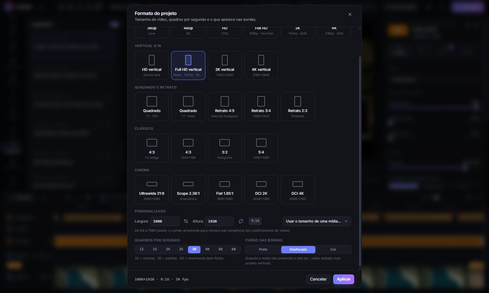</td>
    <td>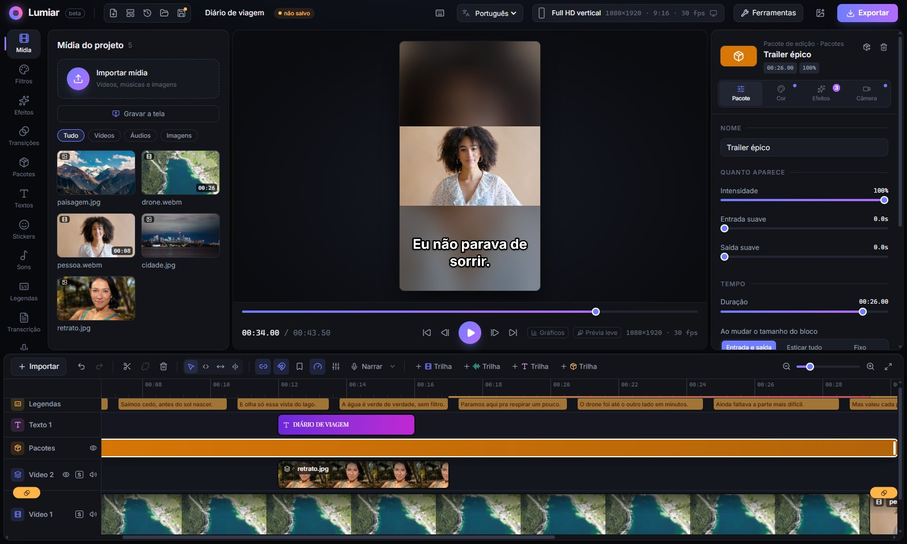</td>
  </tr>
</table>

Na hora de exportar: **MP4, WebM, MOV, GIF animado** ou só o áudio em **WAV/M4A**, de 240p a 8K, de 12 a 60 fps,
em quatro níveis de qualidade. Em **Volume**, o som do vídeo inteiro pode sair no padrão das plataformas (-14 LUFS
para YouTube, Instagram, TikTok e Spotify; -16 para podcast; -23 para TV), com os picos abaixo de -1 dB: não sai baixo
nem é abaixado (e distorcido) pela plataforma. Dá para exportar só um trecho ou salvar o quadro atual como imagem.
Com **Fundo transparente** (WebM com VP9 e alfa, ou **PNG**, uma sequência de imagens num `.zip`), onde não há vídeo
fica transparente: títulos, stickers, elementos animados ou a pessoa recortada vão para outro editor por cima de outro vídeo.
Em **Exportar em vários formatos de uma vez**, marque YouTube (16:9), Reels/TikTok/Shorts (9:16), feed (4:5),
quadrado e um GIF curto, e o Lumiar gera todos em sequência, com o formato no fim do nome (`Meu vídeo - 9x16.mp4`).
Quando a proporção muda, **Seguir o rosto** (padrão) preenche a tela e acompanha quem aparece, como no "Converter para
vertical"; **Mostrar tudo** mantém a imagem inteira com as sobras desfocadas. Durante a exportação, **Continuar editando** fecha a
janela e o progresso fica num cantinho da tela; novas exportações entram na fila.

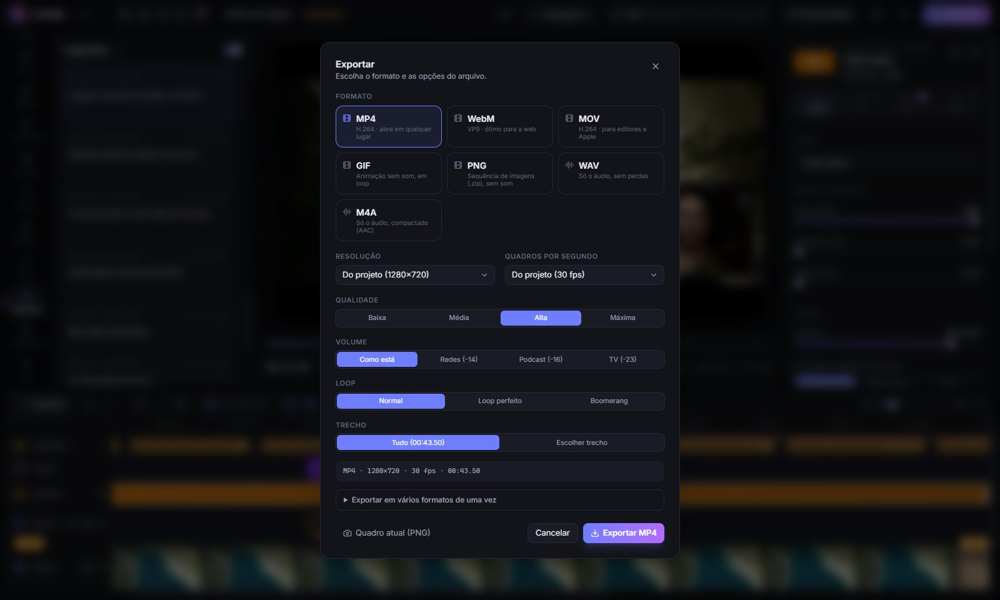

## Instalando

Os instaladores ficam na página de [**Releases**](https://github.com/MikaelCosta05/lumiar/releases/latest).

**Windows (10 ou 11, 64 bits)**
Baixe o `Lumiar-…-Windows-Setup.exe` e abra. Como o instalador não tem assinatura digital, o Windows pode mostrar
"O Windows protegeu o computador". Clique em **Mais informações → Executar assim mesmo**.

**Linux (64 bits)**
No Ubuntu, Debian, Mint, Pop!_OS e derivados, baixe o `Lumiar-…-Linux-x86_64.deb` e instale com dois cliques ou com:

```bash
sudo apt install ./Lumiar-*.deb
```

O Lumiar aparece no menu de aplicativos, com ícone, como qualquer outro programa.

Em outras distribuições, use o `Lumiar-…-Linux-x86_64.AppImage`. Um arquivo baixado não vem marcado como programa,
então o sistema não sabe que é um app até você dar a permissão de execução:

```bash
chmod +x Lumiar-*.AppImage
./Lumiar-*.AppImage
```

(Ou clique com o botão direito → Propriedades → Permitir executar como programa.) Algumas distribuições também
precisam do pacote `libfuse2` para abrir AppImages (`sudo apt install libfuse2`; no Ubuntu 24.04 ou mais novo,
`sudo apt install libfuse2t64`).

**macOS (12 ou mais novo)**
Baixe o `.dmg` do seu Mac: `Lumiar-…-macOS-arm64.dmg` para os com chip da Apple (M1, M2, M3…) ou
`Lumiar-…-macOS-x64.dmg` para os com Intel (em **Maçã → Sobre Este Mac** aparece "Chip" ou "Processador").
Abra o `.dmg` e arraste o Lumiar para a pasta Aplicativos.

O app não tem assinatura da Apple, então o Gatekeeper bloqueia na primeira vez. Clique com o botão direito no
Lumiar → **Abrir** → **Abrir**. No macOS 15 (Sequoia) ou mais novo esse atalho não aparece: tente abrir uma vez,
depois vá em **Ajustes do Sistema → Privacidade e Segurança** e clique em **Abrir Mesmo Assim**, lá embaixo.
Também dá para tirar o bloqueio pelo Terminal:

```bash
xattr -dr com.apple.quarantine /Applications/Lumiar.app
```

Para gravar a tela, o macOS pede a permissão uma vez em **Privacidade e Segurança → Gravação de Tela** (depois de
liberar, feche e abra o Lumiar). O som do computador não entra na gravação no Mac, só o microfone.

> Os instaladores são grandes (cerca de 450 MB) porque já trazem os modelos de IA das legendas, das vozes e da
> detecção de rosto, que funcionam sem internet. Os modelos maiores e menos usados (tradução, busca nas mídias,
> imagens de apoio, foto 3D e efeitos com profundidade, aumentar resolução e separar a voz, de 20 a 150 MB cada) são baixados do Hugging Face
> na primeira vez que a função é usada e ficam guardados no computador.

**Atualizações**: ao abrir, o programa instalado confere se saiu uma versão nova aqui no GitHub e mostra um aviso.
*Atualizar agora* baixa e instala sozinho no Windows e no AppImage; no .deb e no macOS, abre a página para baixar.

## Atalhos

No Mac, use Cmd no lugar do Ctrl. Estes são os padrões: **todos dá para mudar** em Ferramentas → *Atalhos do
teclado* (ou no ícone de teclado no topo, ou apertando **?**). Clique em *Mudar* e aperte a nova combinação; se ela já
for de outra ação, dá para trocar as duas. Tem busca, "Restaurar padrão" em cada uma e em todas, e as dicas dos botões
passam a mostrar a tecla nova. A escolha fica guardada no computador.

| Atalho | O que faz |
|---|---|
| Espaço | Tocar / pausar |
| J / K / L | Tocar para trás / pausar / tocar para frente (de novo: 2× e 4×) |
| ← / → | Um quadro para trás / para frente (com Shift, um segundo) |
| Ctrl + ← / → | Pular para o corte ou marcador anterior / seguinte |
| S | Dividir o clipe no cursor |
| Q / W | Cortar do começo do clipe até o cursor / do cursor até o fim |
| V | Ferramenta de seleção |
| Y / U / N | Ferramentas slip / slide / roll |
| 1 a 9 | Multicâmera: cortar para a câmera |
| Alt + arrastar | Duplicar o item arrastado |
| M | Marcador no cursor |
| R | Gravar / parar a narração |
| Ctrl + C / X / V | Copiar / recortar / colar no cursor |
| Ctrl + D | Duplicar |
| Ctrl + Z / Ctrl + Shift + Z | Desfazer / refazer |
| Ctrl + S / Ctrl + O | Salvar / abrir projeto |
| Delete | Excluir o que está selecionado |
| ? | Ver e mudar os atalhos |
| Ctrl + K | Paleta de comandos: digite o nome de um filtro, efeito, transição, pacote, sticker, som ou ação (sem acento e até com erro de digitação) e aperte Enter para aplicar |

## Rodando pelo código

Precisa do [Node.js](https://nodejs.org) 22 ou mais novo.

```bash
git clone https://github.com/MikaelCosta05/lumiar.git
cd lumiar
npm install
npm run setup   # baixa os modelos de IA (~470 MB, só na primeira vez)
npm run dev     # abre no navegador (Chrome ou Edge)
```

Outros comandos:

| Comando | O que faz |
|---|---|
| `npm run app` | Compila e abre como programa (Electron) |
| `npm run dist:win` | Gera o instalador do Windows em `release/` |
| `npm run dist:linux` | Gera o AppImage e o .deb em `release/` (precisa rodar num Linux ou no WSL) |
| `npm run dist:mac` | Gera o .dmg e o .zip (chip da Apple e Intel) em `release/` (precisa rodar num Mac) |
| `npm run typecheck` | Confere os tipos do TypeScript |
| `npm test` | Roda os testes da lógica (vitest) |
| `npm run e2e` | Abre o Lumiar de verdade (Electron) e clica nele: testes de ponta a ponta |
| `npm run visual:ref` e `npm run visual` | Teste visual dos plugins: grava as imagens de referência antes de mexer e depois aponta o que mudou, com um relatório em `.tmp-visual/relatorio.html` ([detalhes](docs/PLUGINS.md)) |
| `npx electron scripts/bench/run.cjs --ids effects/brilho --out pasta` | Bancada: renderiza plugins e pacotes em alta resolução e mede o tempo por quadro ([detalhes](docs/PLUGINS.md)) |

**Testes de ponta a ponta**: `npm run e2e` compila uma cópia do app em `.tmp-e2e/app` e abre o Lumiar de verdade, com
uma pasta de dados vazia só para o teste (não mexe no seu Lumiar instalado nem nos seus projetos). Os testes ficam em
`e2e/` e usam o [Playwright](https://playwright.dev): abrem o projeto de exemplo, arrastam o cursor pela régua,
importam um vídeo, aplicam um filtro e um pacote, mexem no mixer, usam o slip, o slide e o roll, mudam um atalho, abrem
a galeria sem internet, estabilizam, pré-renderizam, trocam o idioma e exportam um trecho curto. Para rodar só um
arquivo: `npm run e2e -- trim`. Para repetir sem compilar de novo: `LUMIAR_E2E_SKIP_BUILD=1 npm run e2e`. Quando um
teste falha, a imagem da tela e o passo a passo ficam em `.tmp-e2e/resultados`.

**Verificação automática**: a cada push e pull request, o GitHub confere os tipos, roda os testes e compila no Windows,
no Linux e no macOS (`.github/workflows/verificar.yml`). Os testes de ponta a ponta rodam só no computador, porque
precisam de placa de vídeo.

## Como ele funciona por dentro

```
mídia ─► câmera / encaixe ─► efeitos ─► filtro ─┐
                                                ├─► transição ─► camadas de cima ─► pacotes ─► textos ─► tela / arquivo
mídia ─► câmera / encaixe ─► efeitos ─► filtro ─┘
```

O preview e a exportação usam o mesmo renderizador, então o arquivo final sai igual ao que aparece na tela.
As imagens intermediárias são de 16 bits (meia precisão) e a última passada aplica dither antes dos 8 bits da tela e
do vídeo. Todo plugin recebe uma biblioteca de funções (`src/engine/glslLib.ts`: ruído, grão de filme, desfoque,
brilho, aberração cromática, cor em Oklab e luz linear, formas sem serrilhado).
Além da imagem, um efeito (ou um filtro) pode usar a máscara da pessoa, a profundidade, o fundo sem a pessoa, o movimento, os
quadros de até 1 s atrás e uma imagem que ele mesmo guarda de um quadro para o outro; o motor descobre pelo código
do shader o que cada efeito usa e só calcula isso.
Os vídeos são lidos e gravados com o [Mediabunny](https://mediabunny.dev); as legendas e a voz sintética usam
modelos do [Transformers.js](https://huggingface.co/docs/transformers.js) (Whisper e MMS-TTS); a detecção de rosto
usa o [MediaPipe](https://ai.google.dev/edge/mediapipe). A interface é React com Tailwind e o programa de
computador é Electron.

```
src/
├── engine/    renderizador WebGL2 e o sistema de plugins
├── project/   modelo do projeto: trilhas, clipes, câmera, legendas, pacotes, salvar e abrir
├── preview/   reprodução em tempo real
├── media/     importar, exportar, legendas, voz, gravação de tela, GIF, efeitos sonoros, pausas, limpeza do áudio, recorte de fundo, prévia leve
└── ui/        interface
plugins/       filtros, efeitos e transições (uma pasta cada)
electron/      programa de computador
```

## Créditos

As fotos e os vídeos das prévias de filtros e efeitos são do banco gratuito [Pexels](https://www.pexels.com/), sob a
[licença do Pexels](https://www.pexels.com/license/) (uso livre, sem crédito obrigatório); a lista está em
[`public/previews/CREDITOS.md`](public/previews/CREDITOS.md).

O mapa-múndi da rota animada é do [Natural Earth](https://www.naturalearthdata.com/) (domínio público), no formato do
pacote [world-atlas](https://github.com/topojson/world-atlas).
